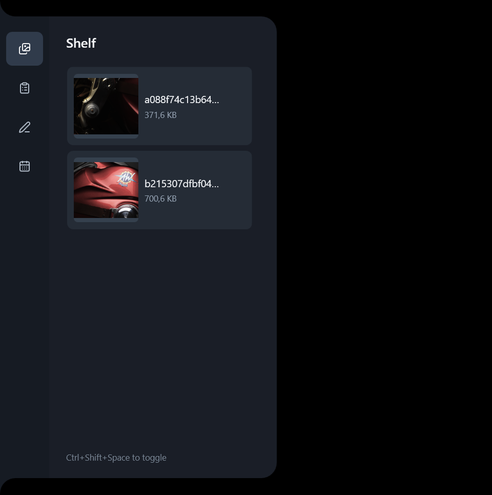
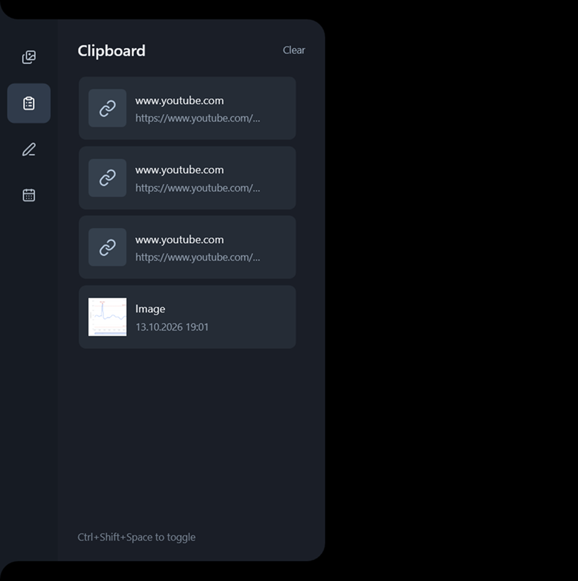
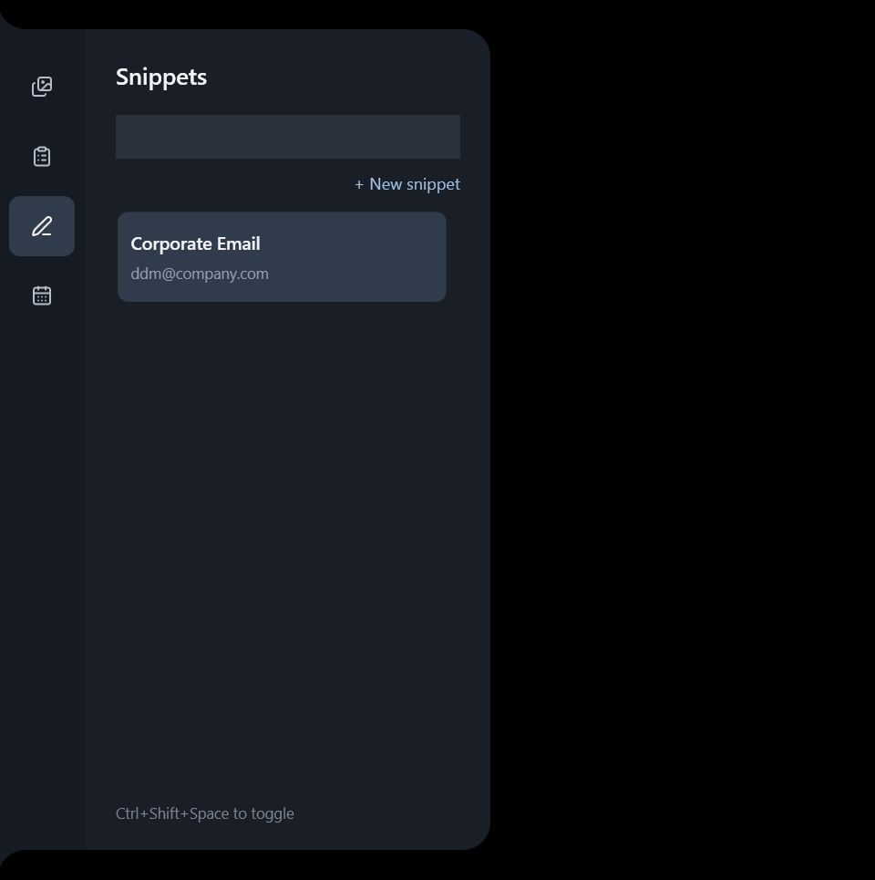
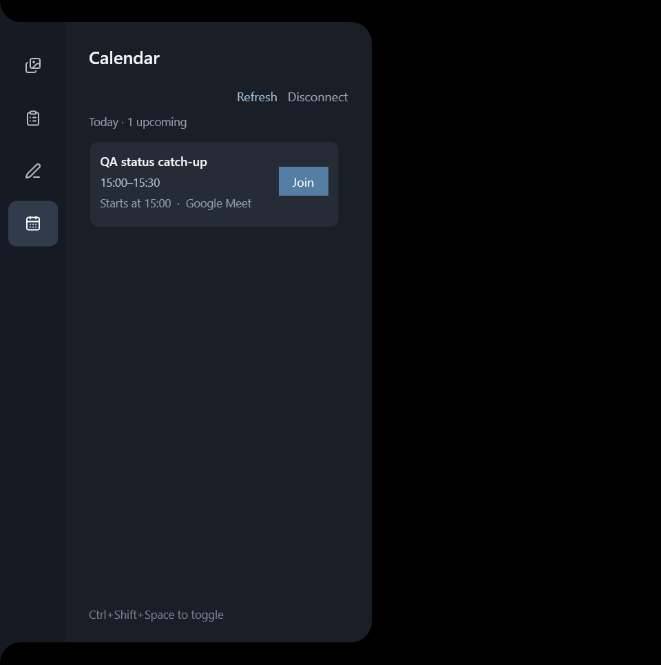

# Edge Shelf

**A lightweight Windows utility that lives on the left edge of your screen and
keeps the things you use throughout the day close at hand.**

Open it by hovering over the left edge of the screen or press:

`Ctrl + Shift + Space`

Edge Shelf has four main sections: **Shelf, Clipboard, Snippets, and Calendar**.

[Download the latest Windows release](https://github.com/Mustey1/edgeshelf/releases/latest)

## Screenshots

| Shelf | Clipboard |
| --- | --- |
|  |  |

| Snippets | Calendar |
| --- | --- |
|  |  |

## Why I built this

I first saw a similar utility on Instagram: someone had vibe-coded a small
productivity app for macOS. I liked the idea, so I decided to build a simpler
version for Windows, focused on the things I actually use.

A large part of my daily work involves screenshots, copied text, links, contact
details, and other small pieces of information that I need constantly. When I
document product states, write requirements, prepare Jira tickets, or discuss
UI, I often take several screenshots in a row and use them somewhere else.

Normally, that means opening folders, searching for files, switching windows,
copying things again, or trying to remember where something was saved.

I wanted a simpler workflow: take screenshots, copy things, keep frequently
used information nearby, and pull it out exactly when needed. No extra windows,
no digging through folders, and fewer unnecessary clicks.

That is why Edge Shelf exists.

## Shelf

Shelf automatically keeps copied screenshots in one place. You can take
multiple screenshots one after another without stopping to paste each one
immediately. They are saved locally and remain available until you remove them.

You can also drop files, folders, or images onto the panel. From Shelf, drag an
item directly into:

- a browser;
- Jira;
- Slack;
- ChatGPT;
- an email;
- File Explorer;
- or any other application that supports drag and drop.

The idea is simple: **capture first, use later**.

## Clipboard

Clipboard keeps a local history of copied content, including:

- text;
- links;
- images and screenshots;
- files and file paths.

Click an item to copy it again, drag compatible items into another application,
pin something useful to Shelf, or delete it when you no longer need it.
Instead of losing whatever you copied five minutes ago, it remains available in
one place.

## Snippets

Snippets are for information you use repeatedly, such as:

- email addresses and phone numbers;
- postal addresses;
- social media and profile links;
- work links;
- frequently used text;
- any other reusable information.

Add a snippet once and keep it permanently available. Click it whenever you
need to copy its value instead of typing it again. Snippets can also be edited,
duplicated, categorized, searched, and deleted.

## Calendar

Calendar provides a simple overview of your upcoming meetings for the day.
Connect Google Calendar through a private iCal link or read-only OAuth and see
your next meetings without constantly opening a separate calendar application.

For supported meetings, a **Join** action opens the meeting directly from the
panel. The goal is to make upcoming meetings harder to miss and easier to
access.

## How it works

Edge Shelf stays attached to the **left edge of the primary screen**. Open it in
either of two ways:

- hover over the left edge;
- press `Ctrl + Shift + Space`.

Move the cursor away when you are done and the panel gets out of the way again.
It remains available throughout the day without permanently taking up screen
space. The tray menu provides **Open**, **Start with Windows**, **Settings**, and
**Quit**.

## Platform and privacy

Edge Shelf supports **Windows 10 and Windows 11**. The installer and portable
release are self-contained, so users do not need to install .NET separately.

Shelf metadata, clipboard history, snippets, and settings stay under
`%LOCALAPPDATA%\EdgeShelf`. Calendar credentials are encrypted for the current
Windows user with DPAPI. Edge Shelf has no project server or analytics.

## Install

Download `EdgeShelf-Setup-<version>.exe` from the
[latest release](https://github.com/Mustey1/edgeshelf/releases/latest). The
installer does not require administrator access. **Start Edge Shelf when I sign
in to Windows** is enabled by default and can later be changed in Settings or
from the tray menu.

A portable ZIP is available alongside the installer. Portable users can enable
startup from the tray menu after placing the application in its permanent
folder.

The binaries are currently unsigned, so Windows SmartScreen may display a
warning until releases are signed with a trusted code-signing certificate.

## Build from source

Requirements: Windows 10/11 and the .NET 8 SDK with Windows desktop support.

```powershell
dotnet restore .\EdgeShelf\EdgeShelf.csproj --configfile .\NuGet.Config
dotnet run --project .\EdgeShelf\EdgeShelf.csproj
```

Create a self-contained portable ZIP and installer with Inno Setup 6:

```powershell
.\scripts\build-release.ps1 -Version 0.1.2
```

Output is written to `artifacts/`. Pass `-SkipInstaller` to build only the
portable ZIP.

## Checks

```powershell
dotnet run --project .\EdgeShelf.Smoke\EdgeShelf.Smoke.csproj
dotnet run --project .\EdgeShelf.UiSmoke\EdgeShelf.UiSmoke.csproj
```

GitHub Actions builds the project and runs both smoke-test projects on Windows.
Pushing a version tag creates a GitHub Release with the installer, portable ZIP,
and SHA-256 checksums.

## License

Edge Shelf is available under the [MIT License](LICENSE). See the
[third-party notices](THIRD_PARTY_NOTICES.md) for included dependencies, icons,
and build tools.
